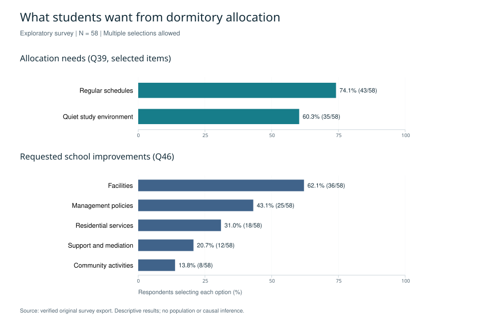
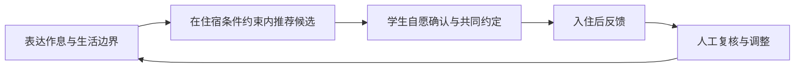

# 关于科学合理分配学生宿舍的研究

[English](README_EN.md) · [研究方法](docs/methodology.md) · [完整发现与口径](docs/findings.md) · [隐私与伦理](docs/privacy-and-ethics.md)

**从学生的共同生活体验出发，探索以作息、安静需求和协商机制改善宿舍分配的路径。**

这是一个以重庆大学本科生为调查对象的探索性社会调查项目，连接问卷研究、需求分析与宿舍辅助分配方案设计。现阶段成果包括调查工具、问卷分析、研究报告和交互原型；公开展示采用 **58 份可追溯原始导出记录**的复算结果，尚未开展可验证的实际分配效果评估。

## 研究背景

宿舍分配决定学生与谁共享休息和生活空间。作息、噪声、清洁习惯及沟通方式的差异，可能影响住宿体验。项目最初从宿舍矛盾出发，进一步关注：即使没有激烈争吵，学生是否仍有未被满足的生活需求，以及这些需求如何进入分配和调宿流程。

## 研究问题

1. 受访学生如何描述调宿意愿、宿舍不适与冲突处理方式？
2. 学生希望分配时考虑哪些生活需求，希望学校改善哪些住宿条件？
3. 如何把调查中的需求转化为可解释、可协商并保留调整渠道的辅助分配流程？

## 方法与数据

原问卷包含 50 个题号，覆盖基本信息、人际关系、生活习惯、宿舍环境、分配偏好和开放建议，并设置条件跳转。现存 57 份与 58 份问卷星导出表的前 57 条记录一致，本版采用 2026 年 6—8 月的 58 份版本。

本版完成原问卷与导出列的对应核查，重新计算频数、比例、均值和中位数，并结合开放回答归纳设计需求。总体指标以 N=58 计算；近期体验的条件题按实际有效回答计算，n=56。开放回答仅转述共同主题，不发布原话或行号。

另有 110 行整理表及基于其产生的历史分析，新增记录的来源尚未确认，本版未采用。既有材料的抽样执行描述不一致，也缺少可核对的招募记录，因此不将本样本描述为已执行的分层随机样本或校园总体代表样本。[方法与局限](docs/methodology.md)说明了复算与历史探索的区别。

## 核心发现

| 发现 | 本样本结果 | 含义 |
| --- | --- | --- |
| 调宿需求值得关注 | 50/58（86.2%）曾考虑调宿或外出租房，或已采取行动 | 这是想法与行动的合并指标，不是实际调宿率或冲突发生率 |
| 不满未必以正面冲突表达 | 28/58（48.3%）选择避免正面冲突但保留不满；21/58（36.2%）选择主动沟通 | 需要关注需求表达与协商，而不仅统计争吵 |
| 作息与安静是明确的分配需求 | 43/58（74.1%）选择作息规律；35/58（60.3%）选择安静学习环境 | 可作为行为化问卷与入住约定的设计依据 |
| 住宿改进同时涉及设施与制度 | 36/58（62.1%）希望改善硬件；25/58（43.1%）希望优化管理 | 辅助匹配应与设施、管理改进结合 |
| 日常不适需要单独测量 | 近期体验题 n=56：周均明显烦躁或焦虑 2.50 天，周均被吵醒或无法入睡 2.34 次，月均言语或情绪冲突 0.39 次 | 回忆窗口和单位不同，不可直接比较数值大小，也不作临床解释 |

图中只展示全样本汇总，不含个体记录、人口学交叉分类或敏感经历。多选题比例不要求相加为 100%。[查看题号、分母和完整解释](docs/findings.md)。

## 宿舍辅助分配框架

以下是由项目材料整理出的**建议流程**，各阶段尚未完成实际效果验证。

问卷应区分“自己通常怎么做”和“希望室友怎么做”，说明可协商范围。候选推荐解释生活习惯差异，允许自愿组队，保留退出及人工调整渠道。健康或特殊住宿需求由适当渠道单独处理，不通过公开画像展示；家庭经济、生源地或心理标签不用于给学生排优劣。

## 实践启示与当前进展

**研究发现**支持进一步关注作息、安静环境和沟通需求。**管理建议**是将需求收集、学生选择、入住约定与适应期调整相连；本调查没有证明该流程能降低冲突，也没有证明任何匹配权重最优。

已有材料包括问卷、阶段汇报、研究报告、历史数据看板、宿舍意向与匹配演示，以及后续趣味角色问答原型。原型不等同于学校已采用的分配系统，自编角色分类也不是经过验证的心理测量工具。为避免传播旧统计与个体引文，本仓库不发布原始看板或其截图。

后续计划来自现有研究材料：核对招募与数据来源，开展问卷认知访谈，在获得支持和自愿参与的前提下进行小范围试用，并预先确定回访与评估指标。目前没有可核对的试用完成、获奖或学校采纳证明，不将这些列为成果。

## 隐私、材料访问与使用

本仓库仅包含重新撰写的研究说明和经过核查的汇总图表。原始调查表、自由文本、内部讨论、署名材料及历史代码保存在独立的私有研究仓库，不在此提供下载。

Raw participant-level data are not publicly released in order to protect participant privacy.

研究文本、图表与数据不因公开展示而自动获得开放再利用授权；本仓库未授予宽泛的数据或内容许可。详见 [使用说明](LICENSE)和[隐私与伦理](docs/privacy-and-ethics.md)。
