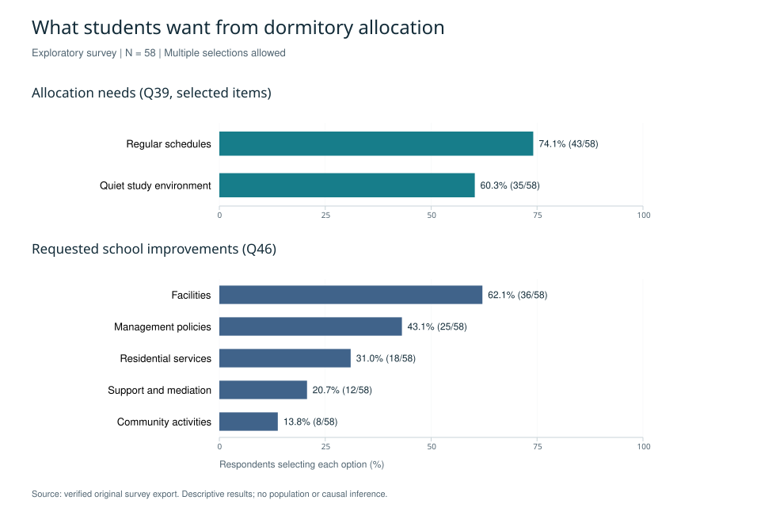
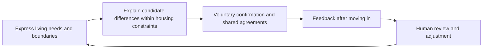

# Student Dormitory Allocation and Shared Living

[中文](README.md) · [Methods](docs/methodology.md) · [Findings](docs/findings.md) · [Privacy and ethics](docs/privacy-and-ethics.md)

**An exploratory survey connecting students' everyday living needs with a proposed dormitory allocation process.**

The project focuses on undergraduate dormitory life at Chongqing University. It brings together questionnaire design, survey analysis, research reports and interface prototypes. This showcase reports descriptive results recalculated from **58 traceable survey export records**. The proposed allocation process has not undergone a verified evaluation in real housing assignments.

## Why this question matters

Students share more than a room: they negotiate sleep, noise, cleanliness and personal boundaries. The project asks how these everyday needs can inform allocation and subsequent adjustments, including situations in which discomfort does not lead to open confrontation.

## Research questions

1. How do respondents describe thoughts of moving, everyday discomfort and conflict responses?
2. Which living needs and institutional improvements do they want the allocation process to address?
3. How can these needs inform a transparent, voluntary process with room for negotiation and later adjustment?

## Study design and evidence

The original questionnaire has 50 numbered questions covering background information, relationships, living habits, the residential environment, allocation preferences and open comments. Conditional questions depend on respondents' housing status.

Two original survey exports contain 57 and 58 records; the first 57 records are identical. The present analysis uses the 58-record export collected between June and August 2026. It checks question coding against the questionnaire, reports descriptive counts and percentages, and uses means and medians for frequency responses. Overall indicators use N=58; the relevant recent-experience questions have n=56 valid responses. Open comments inform paraphrased design themes only.

A separate 110-row working spreadsheet contains additional records whose provenance remains unresolved. Neither those records nor historical results based on them support the current showcase. Documentation of recruitment is incomplete and descriptions of sampling conflict, so the sample is not presented as a verified probability sample or a representative estimate of the university population.

## Key findings

| Observation | Result within this sample | Interpretation |
| --- | --- | --- |
| Interest in changing accommodation | 50/58 (86.2%) had considered changing dormitories or renting elsewhere, or had acted on that intention | Combines thoughts and action; it is not an actual relocation rate |
| Conflict avoidance | 28/58 (48.3%) avoided confrontation while remaining dissatisfied; 21/58 (36.2%) reported proactive communication | Supports attention to how students express and negotiate needs |
| Schedule and quiet-space preferences | 43/58 (74.1%) selected regular schedules; 35/58 (60.3%) selected a quiet study environment | Provides concrete topics for preference collection |
| Facilities and management | 36/58 (62.1%) wanted better facilities; 25/58 (43.1%) wanted management improvements | Matching is only one part of residential support |
| Everyday discomfort | Among 56 valid responses: 2.50 days of marked irritation or anxiety per week, 2.34 sleep interruptions or occasions of difficulty falling asleep per week, and 0.39 verbal or emotional conflicts per month | Different units and recall periods; these are self-reports, not clinical measures |

Multiple selections were allowed for Q39 and Q46. Percentages need not sum to 100%. The figure contains no participant records or demographic cross-tabulations. [Definitions and denominators](docs/findings.md) accompany every result.

## Proposed allocation process

The proposal separates a student's own habits from their expectations of others, explains negotiable differences, allows voluntary grouping and provides an adjustment route. It does not rank students by socioeconomic background or psychological labels. Sensitive accommodation needs should be handled separately through an appropriate institutional channel.

These are design recommendations arising from the project, not demonstrated intervention effects. The study establishes neither optimal matching weights nor a causal reduction in conflict.

## Project status

Existing materials include the questionnaire, survey exports, reports, presentation decks, a historical dashboard, a preference-and-matching demonstration, and a later recreational role quiz. The quiz is a self-developed prototype, not a validated psychometric instrument. Original dashboards and screenshots are withheld because they contain historical statistics or participant quotations.

The documented next steps are to clarify recruitment and data provenance, conduct cognitive interviews, and consider a small voluntary pilot with predefined follow-up measures. Verified evidence of a completed pilot, institutional adoption or awards is not available in the supplied materials.

## Privacy and reuse

Only rewritten research summaries and reviewed aggregate figures appear here. Raw participant-level data are not publicly released in order to protect participant privacy. The full research materials, including private discussions and historical code, are retained in a separate private research repository.

Publication does not grant a general license to reuse the research content, figures or underlying data. See the [use notice](LICENSE) and [privacy statement](docs/privacy-and-ethics.md).
